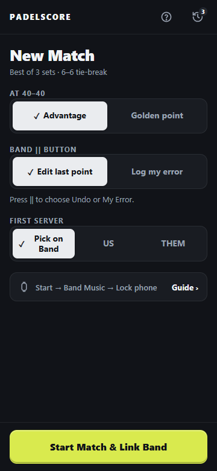
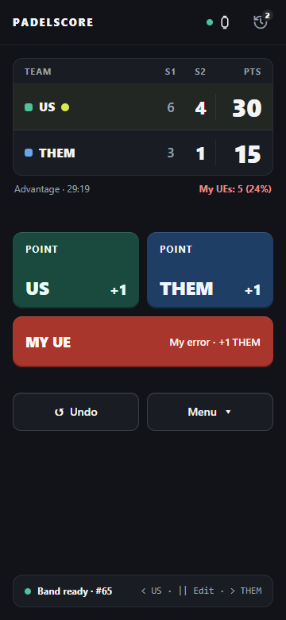
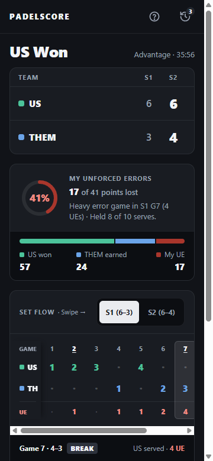
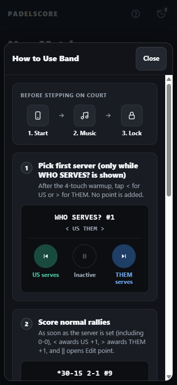
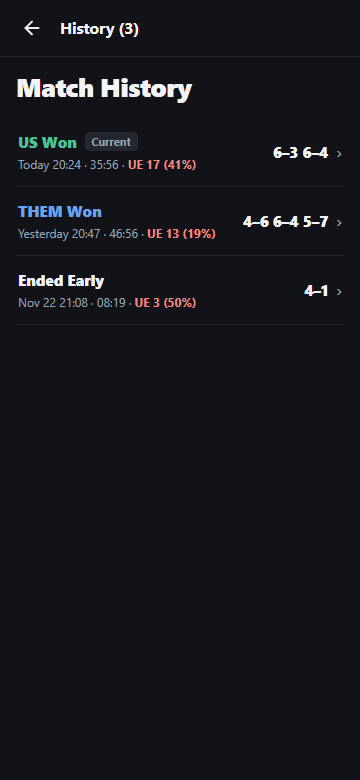

# Padel Scoreboard — Xiaomi Smart Band 9 Active + Offline Android Chrome PWA

Zero-APK Padel Scoreboard, Unforced Error (`MY UE`) tracker, and timestamped match analyzer controlled right from your **Xiaomi Smart Band 9 Active**'s native **Music Controls** (accessible by swiping right during a native Band Workout recording continuous Heart Rate!), powered by an offline Android Chrome PWA using `navigator.mediaSession`.

- **Live Offline PWA:** https://irbbb.github.io/padel-scoreboard/
- **Backlog:** [docs/backlog.md](docs/backlog.md)
- **Research & Learnings:** [docs/research-and-learnings.md](docs/research-and-learnings.md)
- **Hardware Notes:** [docs/hardware-notes.md](docs/hardware-notes.md)
- *(The archived Xiaomi Vela `.rpk` toolchain from `S0.1` is preserved at git tag `vela-s0.1-archive`.)*

---

## App Screens

| Court Setup | Live Scoreboard | Match Result & Set Flow |
| :---: | :---: | :---: |
|  |  |  |
| Advantage / Golden Point, Band `\|\|` mode & thumb-pinned start | Broadcast grid (`S1 · S2 · PTS`), 1-tap pads & live Band footer | Scoreboard, My UE ring card, Set Flow & point-by-point matrix |

| Band 9 Active Visual Guide | Match History |
| :---: | :---: |
|  |  |
| Pre-court checklist & color-coded `<` `\|\|` `>` Band schematics | Local history ledger with scores, duration & UE summary |

---

## Clean-Clone Quick Start (Lean Docker — Zero Host Installs)

All dev tooling (`node:22-alpine` Maintenance LTS + `esbuild`) runs inside a single lean Docker container.

1. **Run pure-JS unit tests (`node --test`)**:
   ```powershell
   docker compose run --rm --build dev npm test
   ```
2. **Build static PWA output (`dist/`)**:
   ```powershell
   docker compose run --rm dev npm run build
   ```

> **After changing `package-lock.json`:** Re-run with `--build` (`docker compose run --rm --build dev ...`, or `docker compose up --build --force-recreate --renew-anon-volumes dev` if keeping a long-lived container) so the container's anonymous `/home/node/app/node_modules` volume refreshes cleanly.
